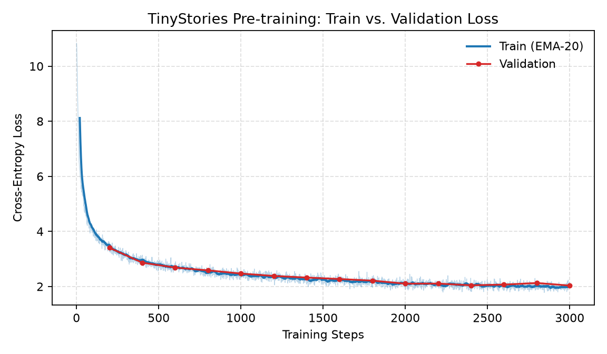
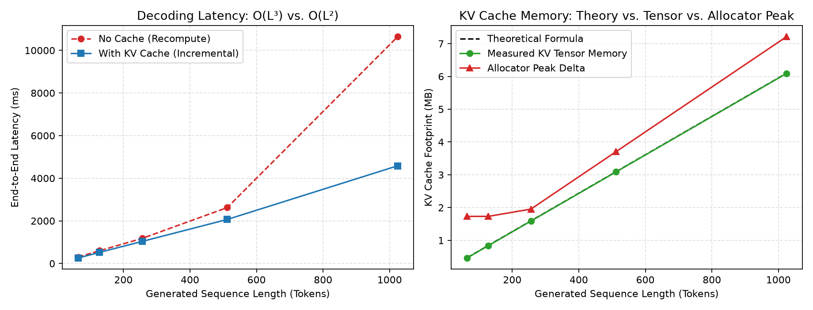

# 轻量化 Llama 式 Transformer 与端侧 KV Cache 推理性能剖析

> 在单张 **RTX 3050 Ti Laptop（4 GB VRAM）** 上，从零实现一个 30.85M 参数的 decoder-only Transformer，
> 完成 BF16 混合精度预训练、KV Cache 推理加速与显存分配器级剖析的全闭环。
>
> 关键词：`PyTorch` · `RoPE` · `RMSNorm` · `SwiGLU` · `KV Cache` · `BF16 AMP` · `CUDA Timing`

---

## 1. 项目简介

本项目基于 Stanford CS336 的课程骨架，用原生 PyTorch 算子手写全部模型组件，目标是回答一个端侧推理的工程问题：

> **在 4 GB 显存的消费级显卡上，一个自回归模型的历史 Token 重复计算到底值多少时间？KV Cache 又能把它压到什么程度？**

整个闭环包含三段：

| 阶段 | 产出 |
|---|---|
| 模型构建 | RMSNorm / RoPE / SwiGLU / Causal MHA 全部手写，30.85M 参数 |
| 混合精度预训练 | 50 MB TinyStories 子集，3000 步，**Train Loss 10.83 → 1.97，Val Loss 3.41 → 2.03** |
| 推理加速与剖析 | Prefill / Decode 解耦 + KV Cache，**L=1024 时 96.3 → 223.4 tok/s（2.32×）**，并给出分配器峰值显存的对账结论 |

---

## 2. 核心架构与工程特性

### 2.1 模型配置

| 项目 | 取值 |
|---|---|
| 架构 | Decoder-only Transformer（Llama 式） |
| 参数量 | **30.85M** |
| 层数 | 6 |
| d_model / num_heads / d_head | 256 / 8 / 32 |
| d_ff（SwiGLU 中间维） | 768 |
| 上下文长度 | 1024 |
| 位置编码 | RoPE（θ = 10000，interleaved 相邻配对） |
| 归一化 | RMSNorm（pre-norm） |
| 激活 | SwiGLU |
| 词表 | 50257（tiktoken GPT-2） |

### 2.2 KV Cache 两阶段推理

解码被显式拆成 Prefill 与 Decode 两条路径：

- **Prefill**：整段 prompt（Q 长度 = S）走标准因果掩码注意力，一次性写入 K/V；
- **Decode**：每步只有 1 个 Query，对长度为 `start_pos + 1` 的全量 cache 做注意力。

缓存容器的三个关键设计：

| 能力 | 实现 |
|---|---|
| 位置对齐 | `start_pos` 显式传入，保证 RoPE 角度与绝对位置一致 |
| 动态追加 | `update()` 每层按 `[B, H, T, d_head]` 追加新 K/V |
| 截断回滚 | `crop(n)` 丢弃末尾 n 个位置，支持采样分支回退 |
| 显存自述 | `memory_bytes()` 按 `numel × element_size` 汇报张量口径占用 |

工程校验：官方测试 **47 passed, 1 xfailed**（BPE 训练、分词器、模型前向全部通过）。

---

## 3. 预训练实验与防过拟合验证

### 3.1 训练配置

| 项目 | 取值 |
|---|---|
| 数据 | TinyStoriesV2-GPT4，按 `<\|endoftext\|>` 边界切分 |
| 训练集 | 50.0 MB / 65,077 条故事 / **12,978,790 tokens** |
| 验证集 | 12.9 MB / 16,619 条故事 / **3,335,614 tokens** |
| 优化器 | AdamW，lr 1e-3，weight decay 0.01，grad clip 1.0 |
| 调度 | 余弦退火至 1e-4（T_max = 3000） |
| 精度 | BF16 autocast（Ampere sm_86） |
| Batch | 8 × 梯度累积 2 = 16，seq len 256 |
| 步数 / 训练量 | 3000 步 / 12,288,000 tokens（约 0.95 轮） |
| 耗时 / 吞吐 | **585.1 s / ≈21,001 tokens/s** |
| 随机性 | 全局 seed 1337 |



### 3.2 结果

- **Train Loss：10.8345 → 1.9654**（图中为 EMA-20 平滑曲线）
- **Val Loss：3.4093 → 2.0341**（每 200 步在 20 个独立 batch 上评测）
- 两条曲线全程贴合，验证集仅高出 **0.06–0.10**，**未出现明显过拟合**。

注：12.29M 训练 token 约为语料的一轮（0.95 epoch），因此 Loss 仍处于下降通道而非平台期。

---

## 4. KV Cache 推理基准与显存对账（核心亮点）

统一在同一 checkpoint 上测量：prompt 16 token、贪心解码、fp16 权重，正式计时前先跑 3 次 16-token 预热解码，
`torch.cuda.synchronize()` 卡住计时边界。正确性由 `torch.equal` 严格断言：
**无缓存重算与 KV Cache 增量推理的 64-token 输出逐 token 完全一致（PASS）**。



| 生成长度 L | 无缓存 (ms) | KV Cache (ms) | 无缓存 (tok/s) | Cache (tok/s) | 加速比 | 张量口径 / 理论 (MB) | 分配器峰值增量 (MB) |
|---:|---:|---:|---:|---:|---:|---:|---:|
| 64 | 302.1 | 258.7 | 211.8 | 247.4 | 1.17× | 0.46 / 0.47 | 1.73 |
| 128 | 599.1 | 520.9 | 213.6 | 245.7 | 1.15× | 0.84 / 0.84 | 1.73 |
| 256 | 1176.5 | 1034.6 | 217.6 | 247.4 | 1.14× | 1.59 / 1.59 | 1.95 |
| 512 | 2623.1 | 2065.9 | 195.2 | 247.8 | 1.27× | 3.09 / 3.09 | 3.71 |
| **1024** | **10638.5** | **4583.0** | **96.3** | **223.4** | **2.32×** | **6.09 / 6.09** | **7.21** |

### 洞察一：为什么短序列只有 1.17×，长序列能到 2.32×

无缓存解码时，生成第 `t` 个 token 需要把长度 `t` 的历史全部重算，单步成本为

```
O(t² · d_head)  [注意力]  +  O(t · d_model · d_head)  [K/V 投影]
```

累计到 L 个 token 就是 `O(L³)`；而 KV Cache 每步只算 1 个 Query，累计为 `O(L²)`，理论上 L 越大优势越大。

但实测的 Cache 吞吐在 L ≤ 256 时几乎恒定（247 tok/s），说明此时**每步耗时被固定开销主导**——
一个 30.85M 参数的小模型，单步计算量只有微秒级，真正占时间的是每层十余次 CUDA Kernel Launch 与
Python dispatch。既然两种模式都卡在同一个常数项 `C₀` 上，比值自然趋近 1：

```
speedup(L) = (C₀ + c·L²) / (C₀ + c'·L)  →  1   (L 很小)
```

到 L=1024，无缓存模式的每 token 计算量涨到 96.3 tok/s，而缓存模式仅因 `torch.cat` 的 O(T) 拷贝
轻微退化到 223.4 tok/s，加速比才真正拉开到 **2.32×**。

### 洞察二：为什么分配器峰值恰好是张量的 1.18 倍

在 T = prompt 16 + 生成 1024 时，KV Cache 的理论占用为

```
2 (K,V) × 6 层 × 8 头 × 32 (d_head) × 1040 × 2 bytes = 6.09 MiB
```

而 `torch.cuda.max_memory_allocated()` 扣除 67.8 MB 基线后实测 **7.21 MiB**，比值 **1.184**。

原因在 `torch.cat` 的扩容方式：第 i 层执行 `cat([old, new])` 的瞬间，旧块尚未释放，
于是**只有正在处理的那一层**同时持有两份；前 i−1 层已经整体替换为新块。因此峰值满足

```
peak / tensor = 1 + 1 / num_layers = 1 + 1/6 = 1.167
```

实测 1.184 略高，差额来自 cat 的临时索引张量与分配器 2 MB 块粒度。这条结论说明：
**KV Cache 不是显存压力的来源**（7.21 MiB 相对于 4 GB 可忽略），真正吃显存的是 61.7 MB 权重
与训练时 `B×S×50257` 的 logits。

> 后续优化方向：把 `torch.cat` 换成预分配缓冲区（`torch.empty(max_len)` + 切片写入），
> 可消除 O(T²) 拷贝，预计进一步拉高长序列加速比并让峰值贴回 1.0×。

---

## 5. 一键复现（Quick Start）

环境：Python 3.13 + [uv](https://docs.astral.sh/uv/) + PyTorch 2.11.0（CUDA 13），单卡 4 GB 即可。

```bash
cd assignments/assignment1-basics
uv sync                                          # 安装依赖

uv run python fetch_data.py                      # 流式拉取 64 MB 语料并切分 train/valid
uv run python train.py                           # 3000 步预训练，约 10 分钟
uv run python profile_kvcache.py                 # KV Cache 基准 + 显存剖析，约 30 秒
```

产物：

| 路径 | 内容 |
|---|---|
| `checkpoints/model.pt` | 训练后的权重（约 118 MB） |
| `assets/training_loss.png` | Train / Val 双曲线 |
| `assets/kv_cache_benchmark.png` | 延迟与显存三线对比图 |
| `../../RUN_RESULTS.md` | 完整实验记录、测量口径与解读 |

> 说明：数据集与权重体积较大，未纳入版本库，由 `fetch_data.py` 与 `train.py` 现场生成。
